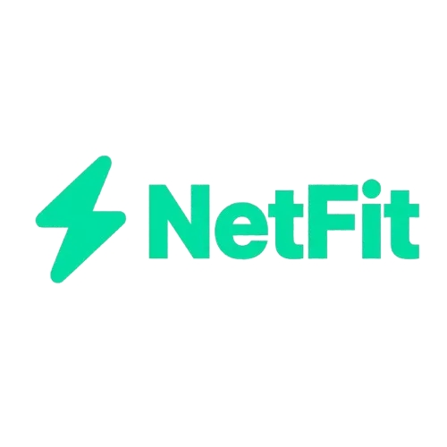
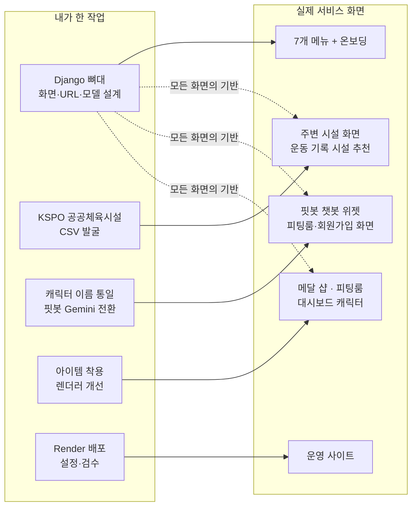
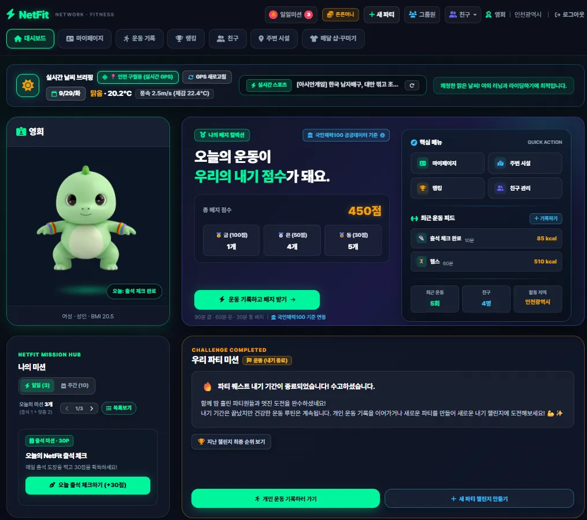
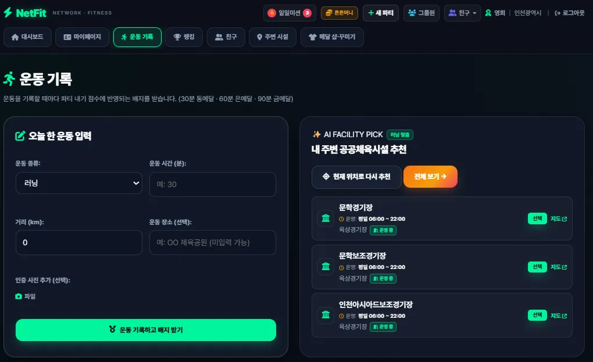
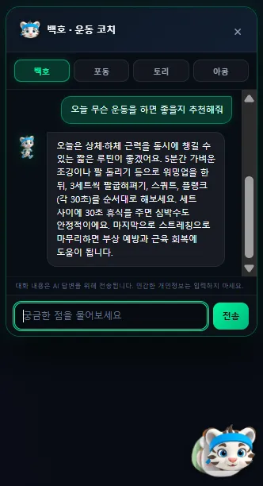
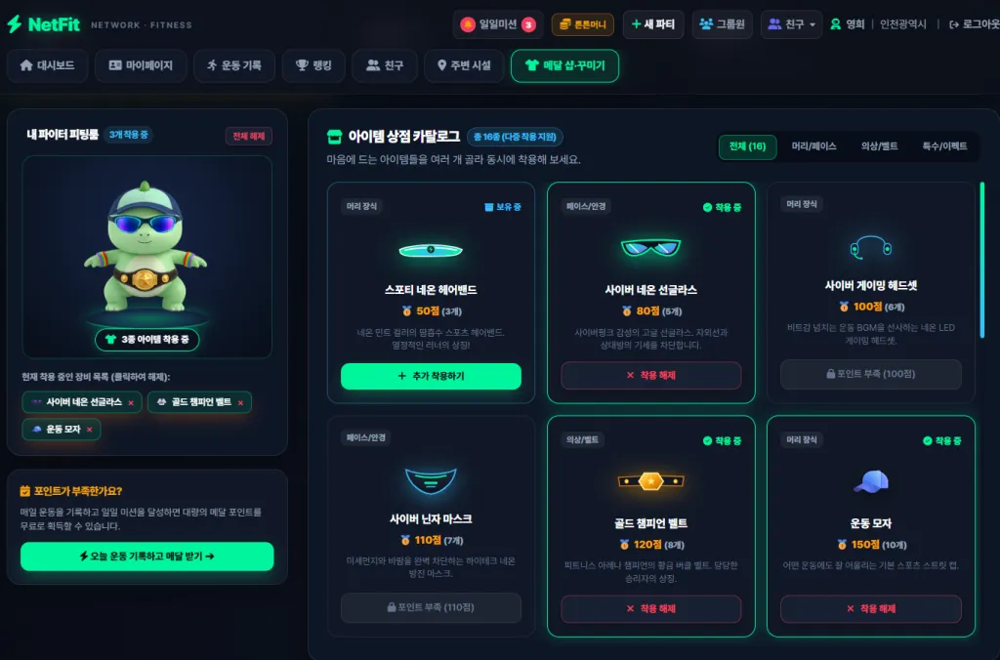

<p align="center">
  
</p>

<h1 align="center">NetFit (넷핏) · 1차 팀 프로젝트</h1>

<p align="center">
  운동 기록이 캐릭터 성장과 친구들과의 내기 점수가 되는 <b>게이미피케이션 피트니스 웹 서비스</b><br/>
  2026 국민체육진흥공단(KSPO) 공공데이터 활용 경진대회 · 서비스 개발 부문 출품작
</p>

<p align="center">
  <a href="https://netfit-production.onrender.com/">배포 사이트</a> ·
  <a href="https://github.com/encore-ai-campus/mlo-02-p1-team4">원본 팀 저장소</a> ·
  <a href="docs/MY_WORK.md">내 작업 상세 기록</a> ·
  <a href="docs/TEAM_README.md">팀 전체 README</a>
</p>

---

## 한눈에 보기

| 항목 | 내용 |
|---|---|
| **기간** | 2026.09.14 ~ 2026.09.29 (약 2주) |
| **팀 구성** | 4명 (팀장 1, 백엔드 1, 프론트엔드 1, 기획 1) |
| **내 역할** | 프론트엔드 · UI/UX · 배포 — **Django 서비스 뼈대와 화면 구조 설계**, 공공데이터 화면 연결, 캐릭터 피팅룸, Render 배포 |
| **기술 스택** | Python, Django, HTML/CSS/JavaScript, SVG, PostgreSQL(Supabase)/SQLite, Gemini API, Render |
| **개발 방식** | 문제 정의·화면 설계·검수·배포는 직접 진행하고, 코드 구현에는 AI 코딩 도구를 함께 활용 |

---

## 작업 요약

| # | 작업 | 결과가 된 화면/기능 |
|:-:|---|---|
| 1 | **Django 프로젝트 뼈대와 전체 화면 구조 설계** | 대시보드·마이페이지·운동 기록·랭킹·친구·주변 시설·메달 샵 7개 메뉴와 온보딩 흐름 |
| 2 | **공공 체육시설 데이터 발굴 및 화면 연결** | 전국 공공체육시설 약 4.5만 건을 불러온 '주변 시설' 화면 |
| 3 | **캐릭터 이름 통일 및 핏봇 호출 코드 Gemini 전환** | 백호·포동·토리·아콩 이름이 모든 화면과 챗봇에 똑같이 나오는 서비스 |
| 4 | **캐릭터 아이템 착용 렌더러 개선** ⭐ | 16종 아이템을 4종 캐릭터에 자연스럽게 겹쳐 입히는 피팅룸 |
| 5 | **종료된 파티가 메뉴에 남는 버그 수정** | 진행 중인 파티만 보이는 상단 그룹원 메뉴 |
| 6 | **Render 운영 배포와 배포 검수** | https://netfit-production.onrender.com/ |

---

## 내 작업이 서비스가 되기까지



---

## 1. Django 서비스 뼈대와 화면 구조 설계

> 관련 파일: `fitness/views.py`, `fitness/urls.py`, `fitness/models.py`, `fitness/templates/`

**무엇을 했나**
- Django 프로젝트(`config`)와 메인 앱(`fitness`)을 만들고, 서비스 전체가 쓰는 **공통 레이아웃(`base.html`)과 상단 7개 메뉴**를 설계했습니다.
- 사용자가 처음 들어와서 운동을 시작하기까지의 **온보딩 흐름**을 화면 단위로 나눴습니다.
  `소개 → 신체 정보 입력 → 코스 선택 → 혼자/함께 선택 → 개인 미션 또는 파티 미션 설정`
- 회원 프로필, 운동 기록, 파티, 미션, 배지, 아이템 구매 같은 **기본 데이터 모델**과 NetFit 네온 테마, 마스코트 선택 화면을 만들었습니다.

**어떤 화면이 되었나**

<p align="center"></p>

- 위 대시보드의 메뉴 구조, 캐릭터 카드, 배지 점수, 미션 영역이 이 뼈대 위에서 만들어졌습니다.
- 이후 팀원들이 카카오 로그인, 실시간 날씨·스포츠 뉴스, DB 연동과 검증 같은 기능을 이 구조 위에 이어 붙였습니다.

---

## 2. 공공 체육시설 데이터 → '주변 시설' 화면

> 관련 파일: `KS_WNTY_PUBLIC_PHSTRN_FCLTY_STTUS_202607.csv`, `fitness/management/commands/import_facilities.py`, `fitness/templates/fitness/facilities.html`

- 공모전 주제인 공공데이터 활용에 맞춰 **국민체육진흥공단의 '전국 공공체육시설 현황' 데이터(약 4.5만 건)**를 직접 찾았습니다.
- 이 CSV를 Django DB로 불러오는 명령(`import_facilities`)과 **'주변 시설' 화면**을 만들어 데이터를 서비스에 연결했습니다.

<p align="center"></p>

- 위 화면의 오른쪽 **"내 주변 공공체육시설 추천"**은 이 데이터를 바탕으로 팀원이 위치 기반 추천과 운영시간 표시 기능을 더해 완성한 것입니다.
- 데이터 검증·자동 동기화 파이프라인은 팀원들이 맡았습니다.

---

## 3. 캐릭터 이름 통일과 핏봇 Gemini 전환

> 관련 파일: `fitness/fitbot_api.py`, `fitness/templates/fitness/fitbot_widget.html`, `fitness/models.py`, `fitness/forms.py`



- 캐릭터가 '햄스터, 아기공룡'처럼 동물 이름으로 불리고, 화면마다 표기도 달랐습니다. 그래서 **백호 · 포동(백곰) · 토리(햄스터) · 아콩(아기공룡)**이라는 고유 이름을 정했습니다. 이 이름을 챗봇·피팅룸·회원가입·친구 화면 등 **이름이 나오는 모든 곳에 한 번에 통일**했습니다.
- 팀에서 Gemini API 키를 준비했는데, 기존 챗봇 코드는 다른 AI 서비스(Groq)를 부르고 있어 "AI 연결 설정이 필요합니다" 오류가 났습니다. 오류 화면을 재현해 원인을 좁혔고, 챗봇 **호출 코드를 Gemini API로 전환**했습니다.
- 이후 팀원이 Groq와 Gemini를 번갈아 쓰는 이중 엔진으로 안정성을 보강했습니다.

<br clear="right"/>

---

## 4. ⭐ 캐릭터 아이템 착용 렌더러 개선 (대표 트러블슈팅)

> 관련 파일: `fitness/static/fitness/js/netfit-outfits.js`, `fitness/static/fitness/css/netfit-outfits.css`, `fitness/templates/fitness/outfit_shop.html`, `fitness/test_outfit_renderer.cjs`

<p align="center"></p>

| 단계 | 내용 |
|---|---|
| **문제** | 헤어밴드·선글라스·마스크 같은 아이템이 캐릭터 얼굴 위에 떠 있거나 서로 겹쳐 보였습니다. 동물마다 이마·눈·귀 위치가 다른데, 아이템 이미지를 모든 캐릭터에 같은 좌표로 붙이고 있었기 때문입니다. |
| **실패한 시도** | 캐릭터마다 위치·크기 보정값을 하나씩 추가하는 방식으로 고쳐 봤지만, 한 캐릭터를 맞추면 다른 캐릭터나 다른 아이템 조합이 틀어졌습니다. 이전 코드로 복구해도 기대한 결과가 나오지 않았습니다. |
| **기준 세우기** | "자연스럽게"라는 말 대신 **"밴드는 이마, 선글라스는 눈, 헤드셋은 귀에, 셋을 동시에 착용해도 겹치지 않게"**라는 확인 가능한 기준을 캡처와 함께 정했습니다. |
| **해결** | 아이템을 따로 움직이는 대신, **이미 캐릭터에 맞게 그려진 착용 원본 이미지에서 필요한 부위만 잘라 보여주는 방식**으로 바꿨습니다. 모든 캐릭터를 같은 627×627 좌표 칸 안에서 다루고, SVG `clipPath`로 아이템 영역만 보이게 해 캐릭터와 아이템이 함께 움직이도록 했습니다. |
| **검수** | 4개 캐릭터 × 대표 조합(밴드+선글라스+헤드셋, 운동복+벨트+글러브 등)을 화면으로 확인했고, 벨트가 운동복을 덮는 문제를 추가로 잡았습니다. 자동 테스트 3건(16종 전체 렌더링, 착용 순서와 무관한 레이어 순서, 캐릭터 간 ID 충돌 방지)을 통과했습니다. |
| **결과** | 3D 엔진 없이 16종 아이템을 4종 캐릭터에 자연스럽게 겹쳐 입히는 피팅룸 완성. 착용 상태가 **피팅룸·대시보드·마이페이지에 동일하게** 반영됩니다. |

---

## 5. 종료된 파티가 메뉴에 남는 버그 수정

> 관련 파일: `fitness/context_processors.py`, `fitness/templates/fitness/base.html`, `fitness/test_party_enhancements.py`

- **문제**: 내기 기간이 끝난 파티가 상단 '그룹원' 메뉴에 계속 남아 있었습니다.
- **1차 수정**: 모든 화면에 공통으로 전달되는 데이터(context processor)에서 **종료일이 지난 파티를 걸러내도록** 했습니다.
- **그래도 남은 문제**: 진행 중인 파티가 하나도 없으면 오히려 전체 파티가 다시 보였습니다. 원인은 템플릿의 ``였습니다. 걸러낸 목록이 비어 있으면 `default`가 **전체 파티 목록으로 되돌려 버리는 구조**였습니다.
- **해결**: `default` 대체 경로를 제거하고, "빈 목록일 때도 종료 파티가 보이지 않는지"를 확인하는 테스트를 추가했습니다.

---

## 6. Render 운영 배포와 배포 검수

> 관련 파일: `render.yaml`, `config/settings.py`, `Procfile`

- 처음 쓰던 Railway 배포 설정을 정리하고 **Render 기준으로 운영 배포 환경을 통일**했습니다. 테스트 브랜치(`testsv`)와 운영 브랜치(`runsv`)를 나눠, 검증된 변경만 운영에 반영했습니다.
- 아이템 수정을 배포할 때 **푸시가 거절**됐습니다. 그사이 팀원이 운영 브랜치에 새 작업을 올렸기 때문입니다. 강제로 덮어쓰면 팀원 작업이 사라질 수 있어서, 원격 변경을 먼저 받아 겹치는 파일이 없는지 확인한 뒤 **내 커밋을 최신 커밋 위에 다시 올려(rebase)** 푸시했습니다.
- 배포 후 Render에서 `Deploy succeeded | Live`를 확인하고, 상태 확인 주소(`/healthz/`)와 새로 추가한 이미지·스크립트 파일이 정상 응답(HTTP 200)하는지까지 점검했습니다.

---

## 트러블슈팅 한눈에 보기

| 문제 | 원인 | 해결 |
|---|---|---|
| 아이템이 얼굴 위에 뜨고 겹침 | 캐릭터마다 다른 신체 위치를 같은 좌표로 처리 | 착용 원본 이미지 + 공통 좌표 + SVG clipPath 렌더러 |
| 벨트가 운동복 일부를 덮음 | 벨트 표시 영역이 너무 넓음 | 벨트 외곽에 맞게 표시 경계 축소 |
| 종료 파티가 메뉴에 남음 | 필터 누락 + 템플릿 `default`가 빈 목록을 전체 목록으로 대체 | 종료일 필터 추가, `default` 경로 제거, 테스트 추가 |
| 챗봇 "AI 연결 설정이 필요합니다" | 준비된 키(Gemini)와 호출하는 서비스(Groq) 불일치 | Gemini API 호출로 전환 |
| 배포 푸시 거절 | 원격 운영 브랜치에 팀원의 새 커밋 존재 | 강제 푸시 대신 변경 확인 후 rebase → 정상 푸시 |

---

## 회고

> *"프론트엔드의 완성도는 보기 좋은 디자인만이 아니라, 기능끼리 자연스럽게 이어지고 실제 배포 환경에서까지 똑같이 동작하는지에 달려 있다는 것을 배웠습니다."*

- **배운 점**
  - "자연스럽게"처럼 모호한 요구를 **캡처와 구체적인 합격 기준**으로 바꿔야 수정과 검수가 빨라진다는 것
  - 로컬 수정 → Git 푸시 → 운영 배포를 구분하고, **실제 사이트에 반영됐는지까지 확인**해야 작업이 끝난다는 것
  - 팀 작업에서는 강제 푸시 대신 **다른 사람의 최신 작업을 지키면서 합치는 방법**이 필요하다는 것
- **아쉬운 점과 다음 계획**
  - 수정 전 정상 화면과 커밋을 미리 기록해 두지 않아 복구 기준이 흔들렸습니다. 다음에는 **수정 전 기준 화면과 승인 조건을 먼저 정하고** 작업하겠습니다.
  - 모든 아이템 조합과 다양한 화면 크기, 이미지 로딩 속도까지는 검수하지 못했습니다.

작업별 상세 과정은 [docs/MY_WORK.md](docs/MY_WORK.md)에 정리했습니다.

---

## 팀 구성

| 이름 | 역할 | 주요 담당 |
|:---:|:---:|---|
| 기욱 | 팀장 · DB / CI·CD / ETL | Supabase DB 구축과 연동, 데이터 정합성 검증, CI/CD와 시설 데이터 ETL 설계 |
| 준범 | 백엔드 · 라이브 기능 / AI | 실시간 날씨·스포츠 뉴스, 파티 챌린지, 주변 시설 비동기 추천, Groq+Gemini 이중 엔진, 시설 자동 동기화 |
| **은서 (나)** | **프론트엔드 · UI/UX / 배포** | **서비스 뼈대와 화면 구조, 공공데이터 화면 연결, 캐릭터 이름 통일, 피팅룸, Render 배포** |
| 어진 | 기획 · 협업 / 문서화 | 카카오 로그인 연동, 팀 가이드와 협업 문서, 커뮤니케이션 구조, 사용자 피드백 조율 |

---

## 실행 방법

```bash
pip install -r requirements.txt
cp .env.example .env          # 필요한 키만 채우기 (카카오·Gemini 키는 선택)
python manage.py migrate
python manage.py import_facilities KS_WNTY_PUBLIC_PHSTRN_FCLTY_STTUS_202607.csv
python manage.py runserver
```

`http://127.0.0.1:8000/` 접속. `DATABASE_URL`이 없으면 SQLite로 자동 실행됩니다.

## 주요 폴더

```text
config/                 Django 설정, URL, 배포 상태 확인
fitness/
├── views.py            화면별 처리 로직
├── models.py           회원·운동 기록·파티·미션·배지·아이템 모델
├── kakao.py            카카오 로그인 (팀원 담당)
├── fitbot_api.py       핏봇(Gemini) 호출
├── context_processors.py  모든 화면 공통 데이터(상단 메뉴 등)
├── templates/fitness/  화면 템플릿
└── static/fitness/     테마 CSS, 캐릭터·아이템 이미지, 착용 렌더러 JS
docs/
├── MY_WORK.md          내 작업 상세 기록
├── TEAM_README.md      팀 전체 README (원본)
└── readme-assets/      README 스크린샷
```
